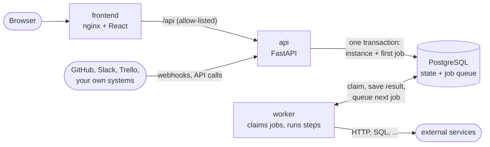
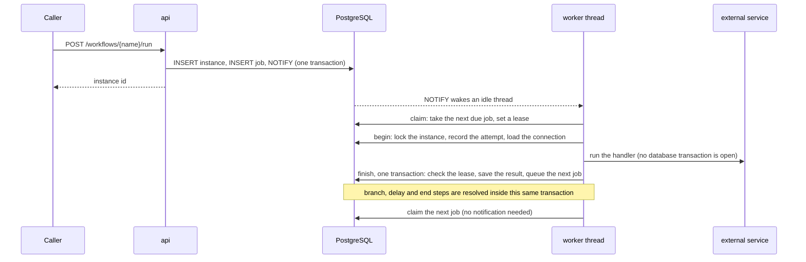

# System Architecture

## Overview

A workflow automation platform in the style of Zapier or n8n. Users define workflows as a graph of steps; the system runs them in response to webhooks, API calls or the UI, and records everything that happened.

Four containers and nothing else:



| Component | Technology | Role |
|---|---|---|
| frontend | React, TypeScript, Vite, nginx | The UI. nginx serves it and proxies `/api` (the metrics, trigger and webhook paths are not proxied). |
| api | FastAPI, gunicorn | Workflow and connection CRUD, starting, cancelling and resuming runs, webhook ingestion, authentication. |
| worker | Python threads | Takes jobs from PostgreSQL and runs steps. Scale with `WORKER_CONCURRENCY` and `--scale worker=N`. |
| postgres | PostgreSQL 17 | Workflow definitions, run state and history, credentials, and the job queue. |

There is no message broker, cache or scheduler process. A job is a row; waiting, retrying and timing out are the same column (`run_at`). The reasoning is in [ADR 0017](adr/0017-postgres-backed-job-queue-replaces-outbox-broker-and-celery.md) and [ADR 0018](adr/0018-one-job-per-step-with-lease-fencing-and-single-transaction-advance.md).

---

## Core concepts

### Workflow definition

A workflow is a versioned JSON document in `workflow_versions.definition`. Saving a new version deactivates the old one; instances stay pinned to the version they started on.

```json
{
  "trigger": { "connector_id": "github", "trigger_id": "github_issue_opened", "config": { "repository": "acme/widgets" } },
  "start_at": "check_labels",
  "steps": {
    "check_labels": {
      "type": "branch",
      "condition": { "field": "issue.title", "operator": "contains", "value": "crash" },
      "on_true": "notify_slack",
      "on_false": "end"
    },
    "notify_slack": {
      "type": "action",
      "connector_id": "slack",
      "action_id": "slack_send_message",
      "connection_id": "<connection-uuid>",
      "config": { "text": "New issue: {{issue.title}}" },
      "retry": { "max_attempts": 3, "delay_seconds": 5 },
      "next": "end"
    }
  }
}
```

| Step type | What it does |
|---|---|
| `action` (default) | Calls a connector handler (Slack, GitHub, Trello, HTTP, PostgreSQL, webhook, transform, log). |
| `branch` | Evaluates a condition on the instance data (`eq neq gt gte lt lte contains exists`, dot paths) and continues at `on_true` or `on_false`. |
| `delay` | Waits `duration_seconds` (any step with `duration_seconds` is a delay). |
| `wait_for_event` | Pauses until `POST /instances/{id}/events`, with an optional `timeout_seconds` after which the instance fails. |

`{{field.path}}` in a step's `config` is replaced with values from the instance data, once, by the engine, before the handler runs. A handler can name config keys that are never templated (the SQL handlers do, for `query` and `connection_string`).

### Instances, steps and jobs

- A **workflow instance** is one run. Status: `pending` then `running` then `completed`, `failed` or `cancelled`. `data` is a JSON object that accumulates what each step changed.
- A **step execution** is one attempt at one step: a row with status, the attempt number, the error text if it failed, and the data the step changed (`output_data`). A retried step has one row per attempt.
- A **job** is the unit of work: "run step X of instance Y, no earlier than T". An instance has at most one live job, because workflows are sequential. Finished jobs are deleted; the table holds only work to do (`queued`, `running`) and jobs that gave up (`dead`).

---

## How a run executes



1. **Start.** The API inserts the instance and its first job in one transaction and notifies the workers. Webhook deliveries from GitHub, Slack and Trello are verified first, then start every matching workflow the same way.
2. **Claim.** A worker thread runs `UPDATE jobs ... WHERE id = (SELECT ... FOR UPDATE SKIP LOCKED LIMIT 1)`. The job becomes `running` with a lease (`locked_until`). Several workers can claim at once without coordination.
3. **Begin.** In a short transaction the thread locks the instance row, closes any attempt a dead worker left open, records the new attempt, and loads the step's connection credentials.
4. **Run.** The engine resolves `{{templates}}` and calls the handler. No database transaction or lock is held while it runs, so a slow HTTP call costs no connection.
5. **Finish.** One transaction: it locks the instance and checks the job's lease is still this worker's. If so it stores the step's data, marks the attempt completed, deletes the job and works out what comes next. Branches are evaluated and delays added up right here; the first action or wait step becomes the next job. If the step failed, it either re-queues the same job after `retry.delay_seconds` or marks the job dead and the instance failed, with the error text.
6. **Repeat.** The same thread claims again. No notification is needed for the job it just queued.

Cancelling and resuming (`cancel`, `events`) take the same instance row lock, so they cannot interleave with a step finishing. A step that finishes after its instance was cancelled discards its result.

---

## Key database tables

| Table | Purpose |
|---|---|
| `workflows` | Workflow identity (name, id) |
| `workflow_versions` | Versioned definitions (JSONB), one active per workflow |
| `workflow_instances` | One row per run: status, current step, accumulated data, request id |
| `workflow_step_executions` | One row per attempt: status, attempt number, data changed, error text |
| `jobs` | The queue: step to run, `run_at`, lease (`locked_by`, `locked_until`), attempt and claim counts |
| `connections` | Stored connector credentials (plaintext JSONB; see [ADR 0011](adr/0011-connection-credentials-stored-in-postgres.md)) |

`infrastructure/postgres/init.sql` creates all of it, plus a seeded example workflow. Migrations for existing databases live in `infrastructure/postgres/migrations/`.

---

## Services at a glance

| Service | Entry point | Command |
|---|---|---|
| api | `src/api/main.py` | `gunicorn -k uvicorn.workers.UvicornWorker src.api.main:app` |
| worker | `src/worker/main.py` | `python -m src.worker.main` |
| frontend | `frontend/` | nginx serving the built app |
| postgres | | `postgres:17-alpine` |

Code layout: `src/api` (routers, service, repository, webhook trigger handlers, auth), `src/engine` (`runtime.py` the queue and state machine, `steps.py` pure logic, `worker.py` threads), `src/worker` (process entry point, connector handlers and their registry), `src/shared` (database pool, connector catalogue, outbound-request guard, errors, logging, metrics).

Security controls (API key, webhook signatures, outbound-request guard, network exposure) are described in [ADR 0020](adr/0020-shared-api-key-authentication-and-private-internal-services.md) and [ADR 0021](adr/0021-guard-outbound-requests-from-workflow-handlers.md).
